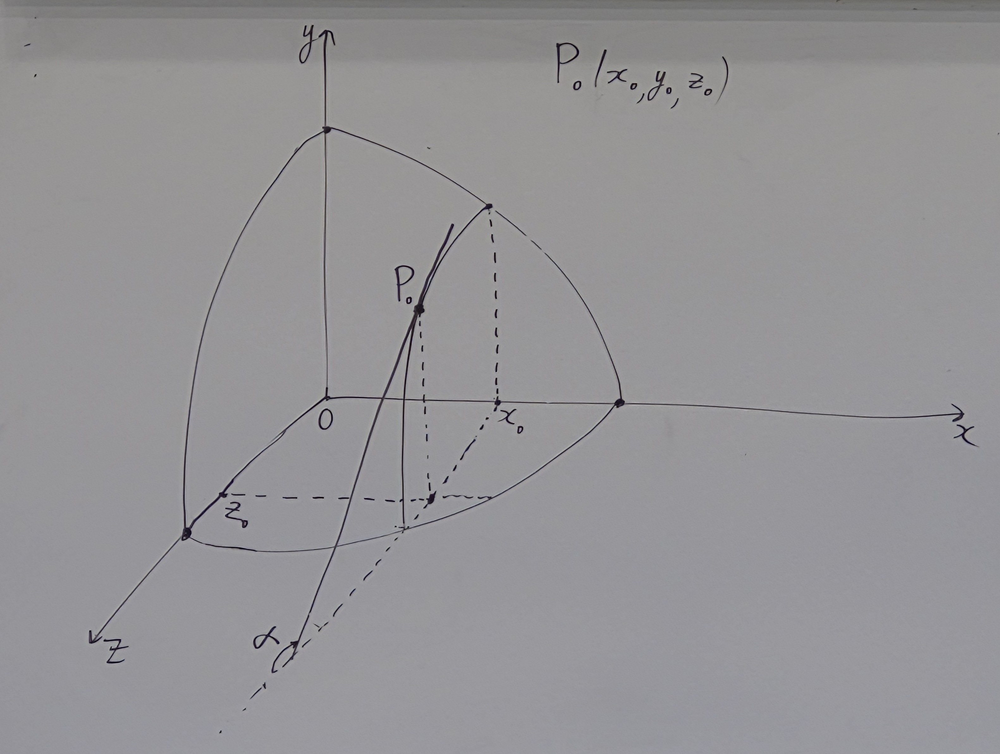
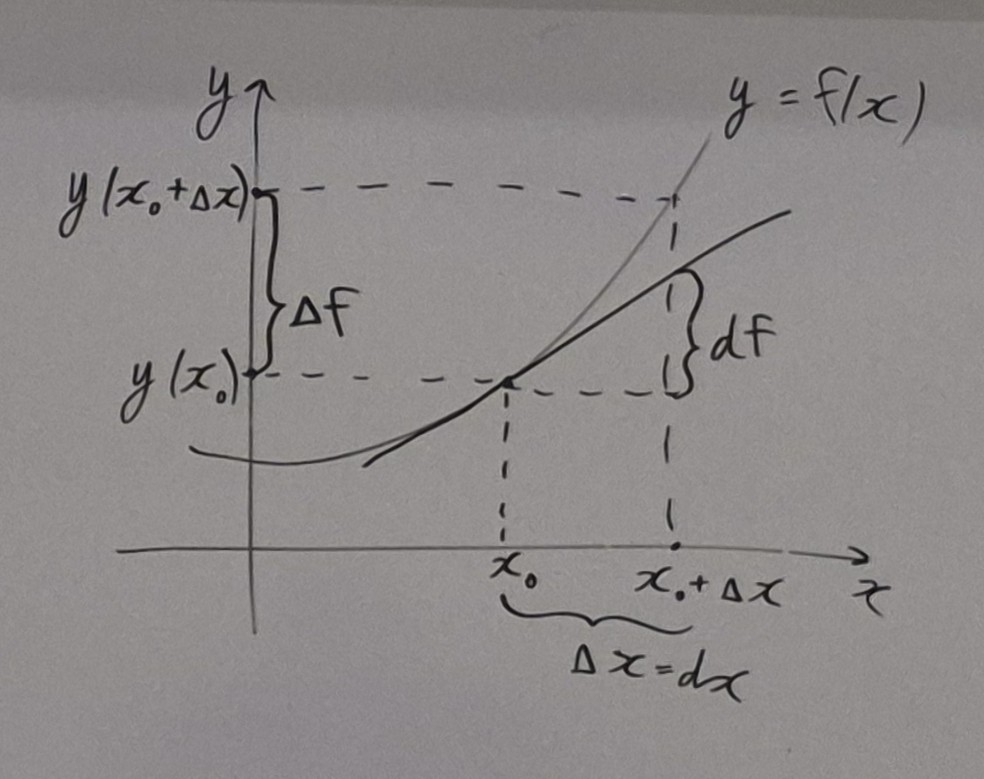

# 1.4 Частные производные

**Частная производная** -- это предел отношения приращения функции по одной из переменных к приращению этой переменной, когда последнее стремится к нулю, при фиксированных значениях остальных переменных.

Для функции $u = f(x, y, z)$, определенной в некоторой области $D$, выберем точку $P_0(x_0, y_0, z_0)$. Если переменные $y$ и $z$ остаются постоянными ($y = y_0$, $z = z_0$), то функция $u$ становится функцией одной переменной $x$. Её частная производная по $x$ определяется как:

$$
f'_x \equiv \frac{\partial f}{\partial x}(x_0, y_0, z_0) = \lim_{\Delta x \to 0} \frac{f(x_0 + \Delta x, y_0, z_0) - f(x_0, y_0, z_0)}{\Delta x}
$$

> [!note] Обозначение производной
> Символ $\frac{\partial f}{\partial x}$ является единым оператором. Следует отличать его от полной производной, которая представляет собой отношение дифференциалов $df$ и $dx$.

> [!note]- Геометрический смысл частной производной
> Тангенс угла наклона касательной -- это геометрический смысл частной производной. В трёхмерном пространстве функция двух переменных $z = f(x, y)$ задаёт некоторую поверхность. На этой поверхности выберем точку $P_0$ и проведём через неё плоскость, параллельную координатной плоскости $ZOY$ ($x = x_0$). Пересечение поверхности и этой плоскости даёт кривую. Тангенс угла наклона касательной к этой кривой в точке $P_0$ равен частной производной функции по $y$ в данной точке:
> $$
> \operatorname{tg}\alpha = \frac{\partial f}{\partial y}(x_0, y_0)
> $$
>
> 
>
> Если провести плоскость, параллельную $ZOX$ ($y = y_0$), то аналогичное построение покажет, что тангенс угла наклона касательной будет равен частной производной $\frac{\partial f}{\partial x}(x_0, y_0)$.

# 1.5 Полное приращение и полный дифференциал

**Полное приращение функции** -- это разность значений функции во взаимно смещённых точках. Для функции $u = f(x, y, z)$ в области $D$ полное приращение в точке $(x_0, y_0, z_0)$ определяется формулой:

$$
\Delta u = f(x_0 + \Delta x, y_0 + \Delta y, z_0 + \Delta z) - f(x_0, y_0, z_0)
$$

> [!theorem] Теорема 7 (О достаточном условии дифференцируемости)
> Пусть частные производные $f'_x$, $f'_y$, $f'_z$ существуют в некоторой окрестности точки $(x_0, y_0, z_0)$ и непрерывны в самой точке $(x_0, y_0, z_0)$.
>
> Тогда полное приращение функции $\Delta u$ представимо в виде:
> $$
> \Delta u = f'_x(x_0, y_0, z_0) \cdot \Delta x + f'_y(x_0, y_0, z_0) \cdot \Delta y + f'_z(x_0, y_0, z_0) \cdot \Delta z + \alpha \cdot \Delta x + \beta \cdot \Delta y + \gamma \cdot \Delta z
> $$
> где $\alpha, \beta, \gamma$ -- бесконечно малые величины при $\Delta x, \Delta y, \Delta z \to 0$.
>
> > [!proof]- Доказательство
> > Полное приращение представимо в виде суммы разностей по отдельным переменным:
> > $$
> > \Delta u = [f(x_0 + \Delta x, y_0 + \Delta y, z_0 + \Delta z) - f(x_0, y_0 + \Delta y, z_0 + \Delta z)] + [f(x_0, y_0 + \Delta y, z_0 + \Delta z) - f(x_0, y_0, z_0 + \Delta z)] + [f(x_0, y_0, z_0 + \Delta z) - f(x_0, y_0, z_0)]
> > $$
> > Применим теорему Лагранжа о конечном приращении для функции одной переменной к каждому слагаемому последовательно:
> >
> > 1. Для первой разности (изменение по $x$):
> > $$
> > f(x_0 + \Delta x, y_0 + \Delta y, z_0 + \Delta z) - f(x_0, y_0 + \Delta y, z_0 + \Delta z) = f'_x(x_0 + \theta_1 \Delta x, y_0 + \Delta y, z_0 + \Delta z) \cdot \Delta x
> > $$
> > где $0 < \theta_1 < 1$. Так как $f'_x$ непрерывна в точке $(x_0, y_0, z_0)$, значение производной в смещенной точке стремится к её значению в исходной точке:
> > $$
> > f'_x(x_0 + \theta_1 \Delta x, y_0 + \Delta y, z_0 + \Delta z) = f'_x(x_0, y_0, z_0) + \alpha
> > $$
> > где $\alpha \to 0$ при стремлении к нулю приращений переменных.
> >
> > 2. Для второй разности (изменение по $y$):
> > $$
> > f(x_0, y_0 + \Delta y, z_0 + \Delta z) - f(x_0, y_0, z_0 + \Delta z) = f'_y(x_0, y_0 + \theta_2 \Delta y, z_0 + \Delta z) \cdot \Delta y
> > $$
> > где $0 < \theta_2 < 1$. В силу непрерывности $f'_y$:
> > $$
> > f'_y(x_0, y_0 + \theta_2 \Delta y, z_0 + \Delta z) = f'_y(x_0, y_0, z_0) + \beta
> > $$
> > где $\beta \to 0$ при стремлении к нулю приращений переменных.
> >
> > 3. Для третьей разности (изменение по $z$):
> > $$
> > f(x_0, y_0, z_0 + \Delta z) - f(x_0, y_0, z_0) = f'_z(x_0, y_0, z_0 + \theta_3 \Delta z) \cdot \Delta z
> > $$
> > где $0 < \theta_3 < 1$. В силу непрерывности $f'_z$:
> > $$
> > f'_z(x_0, y_0, z_0 + \theta_3 \Delta z) = f'_z(x_0, y_0, z_0) + \gamma
> > $$
> > где $\gamma \to 0$ при стремлении к нулю приращений переменных.
> >
> > Подставив полученные соотношения в исходное выражение, получаем:
> > $$
> > \Delta u = f'_x(x_0, y_0, z_0) \cdot \Delta x + f'_y(x_0, y_0, z_0) \cdot \Delta y + f'_z(x_0, y_0, z_0) \cdot \Delta z + \alpha \cdot \Delta x + \beta \cdot \Delta y + \gamma \cdot \Delta z
> > $$

> [!corollary] Следствие из теоремы 7 (О непрерывности)
> Если в некоторой окрестности точки $(x_0, y_0, z_0)$ существуют частные производные и они непрерывны в самой точке $(x_0, y_0, z_0)$, то функция $f(x, y, z)$ непрерывна в этой точке.
>
> > [!proof]- Доказательство
> > Обозначим $\rho = \sqrt{\Delta x^2 + \Delta y^2 + \Delta z^2}$. Преобразуем сумму бесконечно малых членов:
> > $$
> > \alpha \cdot \Delta x + \beta \cdot \Delta y + \gamma \cdot \Delta z = \left( \alpha \frac{\Delta x}{\rho} + \beta \frac{\Delta y}{\rho} + \gamma \frac{\Delta z}{\rho} \right) \cdot \rho
> > $$
> > Так как отношение приращения координаты к расстоянию ограничено по модулю единицей:
> > $$
> > \frac{|\Delta x|}{\rho} \le 1, \quad \frac{|\Delta y|}{\rho} \le 1, \quad \frac{|\Delta z|}{\rho} \le 1
> > $$
> > а величины $\alpha, \beta, \gamma$ являются бесконечно малыми при $\rho \to 0$, то выражение в скобках также стремится к нулю:
> > $$
> > \left( \alpha \frac{\Delta x}{\rho} + \beta \frac{\Delta y}{\rho} + \gamma \frac{\Delta z}{\rho} \right) \xrightarrow{\rho \to 0} 0
> > $$
> > Значит, вся добавочная часть представляет собой бесконечно малую величину более высокого порядка относительно $\rho$:
> > $$
> > \alpha \cdot \Delta x + \beta \cdot \Delta y + \gamma \cdot \Delta z = o(\rho)
> > $$
> > Тогда полное приращение функции принимает вид:
> > $$
> > \Delta u = f'_x(x_0, y_0, z_0) \cdot \Delta x + f'_y(x_0, y_0, z_0) \cdot \Delta y + f'_z(x_0, y_0, z_0) \cdot \Delta z + o(\rho)
> > $$
> > Откуда при $\rho \to 0$ получаем:
> > $$
> > \Delta u \xrightarrow{\rho \to 0} 0
> > $$
> > Это означает непрерывность функции в точке $(x_0, y_0, z_0)$.

**Дифференцируемая функция в точке** -- это функция $u = f(x, y, z)$, полное приращение которой в точке $(x_0, y_0, z_0)$ представимо в виде:

$$
\Delta u = A \cdot \Delta x + B \cdot \Delta y + C \cdot \Delta z + o(\rho)
$$

где $A, B, C = \text{const}$, а $\rho = \sqrt{\Delta x^2 + \Delta y^2 + \Delta z^2}$.

> [!theorem] Теорема 8 (Связь дифференцируемости и частных производных)
> Пусть функция $u = f(x, y, z)$ дифференцируема в точке $(x_0, y_0, z_0)$, то есть её приращение представимо в виде:
> $$
> \Delta u = A \cdot \Delta x + B \cdot \Delta y + C \cdot \Delta z + o(\rho)
> $$
>
> Тогда в этой точке существуют частные производные функции, причем они равны соответствующим коэффициентам:
> $$
> A = f'_x(x_0, y_0, z_0), \quad B = f'_y(x_0, y_0, z_0), \quad C = f'_z(x_0, y_0, z_0)
> $$
>
> > [!proof]- Доказательство
> > Положим $\Delta y = \Delta z = 0$. Тогда расстояние $\rho = |\Delta x|$. Полное приращение превращается в частное приращение по $x$:
> > $$
> > \Delta_x u = f(x_0 + \Delta x, y_0, z_0) - f(x_0, y_0, z_0)
> > $$
> > С другой стороны, подставляя $\Delta y = \Delta z = 0$ в представление приращения, получаем:
> > $$
> > \frac{\Delta_x u}{\Delta x} = A + B \cdot \frac{0}{\Delta x} + C \cdot \frac{0}{\Delta x} + \frac{o(|\Delta x|)}{\Delta x} = A + \frac{o(|\Delta x|)}{\Delta x}
> > $$
> > При предельном переходе $\Delta x \to 0$ слагаемое $\frac{o(|\Delta x|)}{\Delta x}$ стремится к нулю, поэтому по определению частной производной:
> > $$
> > f'_x(x_0, y_0, z_0) = A
> > $$
> > Аналогично, полагая приращения других пар переменных равными нулю, доказываем равенства для $B$ и $C$.

По теореме 8 коэффициенты $A$, $B$, $C$ равны частным производным, поэтому представимость полного приращения можно записать в виде:

$$
\Delta u = f'_x(x_0, y_0, z_0) \cdot \Delta x + f'_y(x_0, y_0, z_0) \cdot \Delta y + f'_z(x_0, y_0, z_0) \cdot \Delta z + o(\rho)
$$

**Полный дифференциал функции** -- это главная линейная часть полного приращения функции. Выражение

$$
df = f'_x(x_0, y_0, z_0) \cdot \Delta x + f'_y(x_0, y_0, z_0) \cdot \Delta y + f'_z(x_0, y_0, z_0) \cdot \Delta z
$$

называется дифференциалом функции $f(x, y, z)$, или полным дифференциалом.

> [!note] Замечание об условии дифференцируемости
> Теорема 7 устанавливает: если частные производные $f'_x$, $f'_y$, $f'_z$ существуют в некоторой окрестности точки $(x_0, y_0, z_0)$ и непрерывны в самой точке $(x_0, y_0, z_0)$, то приращение функции представимо в указанном выше виде. По сравнению с функцией одной переменной здесь появилось условие непрерывности частных производных в точке. Это условие не является необходимым: в теореме 8 оно не понадобилось.

> [!note] Дифференцируемость и частные производные
> Для функции нескольких переменных утверждение «функция дифференцируема в данной точке» уже не эквивалентно утверждению «функция имеет частные производные по всем переменным» в данной точке, а означает больше. Обычно предполагается существование и непрерывность частных производных, что перекрывает условие дифференцируемости.

# 1.6 Геометрический смысл дифференциала функции нескольких переменных

Перед тем как объяснять геометрический смысл дифференциала функции нескольких переменных, напомним геометрический смысл дифференциала функции одной переменной.

Касательную $M_0T$ можно определить как предельное положение секущей при условии, что длина $M_0M$ стремится к нулю. Можно дать и другое определение касательной, эквивалентное первому.

**Касательная к кривой в точке** -- это прямая $M_0T$, если расстояние $MP$ переменной точки $M$ кривой $y = f(x)$ от прямой $M_0T$, при стремлении расстояния $M_0M$ к нулю, является бесконечно малой величиной более высокого порядка малости, чем $M_0M$ (то есть если отношение $\frac{MP}{M_0M}$ при этом стремится к нулю). Следовательно, $\sin \varphi \to 0$, а значит стремится к нулю угол $\varphi$ между секущей $M_0M$ и касательной $M_0T$.

По аналогии с определением касательной прямой дадим определение касательной плоскости.

**Касательная плоскость** -- это плоскость $P$, если расстояние $MP$ переменной точки $M$ поверхности $z = f(x, y)$ от этой плоскости, при стремлении расстояния $M_0M$ к нулю, является бесконечно малой величиной более высокого порядка малости, чем $M_0M$ (то есть если отношение $\frac{MP}{M_0M}$ при этом стремится к нулю).

Пусть поверхность $S$ задана уравнением $z = f(x, y)$. Обозначим за $M(x, y, z)$ произвольную точку на этой поверхности. Возьмём на ней точку $M_0(x_0, y_0, z_0)$ и исследуем, при каких условиях плоскость $P$, проходящая через точку $M_0$ и имеющая уравнение

$$
Z - z_0 = A \cdot (x - x_0) + B \cdot (y - y_0)
$$

будет являться касательной плоскостью для поверхности $S$.

> [!theorem] Теорема 9 (Касательная плоскость)
> Поверхность $z = f(x, y)$ имеет касательную плоскость в точке $M_0(x_0, y_0, z_0)$ тогда и только тогда, когда функция $z = f(x, y)$ дифференцируема в точке $(x_0, y_0)$.
>
> В этом случае уравнение касательной плоскости в точке $M_0(x_0, y_0, z_0)$ имеет вид:
> $$
> Z - z_0 = f'_x(x_0, y_0) \cdot (x - x_0) + f'_y(x_0, y_0) \cdot (y - y_0)
> $$
>
> > [!proof]- Доказательство
> > Проведём через точку $M$ прямую $ML$, параллельную оси $OZ$, и опустим из точки $M_0$ на неё перпендикуляр $M_0N$. Треугольник $MPK$ прямоугольный, поэтому отрезок $MK$ отличается от $MP$ постоянным множителем $\cos(\angle KMP)$, причём угол $\angle KMP$ не меняется при перемещении точки $M$. Значит, вместо отношения $\frac{MP}{M_0M}$ можно рассматривать отношение $\frac{MK}{M_0M}$.
> >
> > Кроме того, можно заменить в этом отношении расстояние $r = M_0M$ на отрезок $\rho = M_0N$. Такая замена требует обоснования: расстояния $M_0M$ и $M_0N$ отличаются на множитель $\cos(\angle MM_0N)$, однако при перемещениях точки $M$ угол $\angle MM_0N$ может меняться, а вместе с ним будет меняться и косинус.
> >
> > Введём обозначения $\Delta x = x - x_0$, $\Delta y = y - y_0$, $\Delta z = z - z_0$. Точки $M$ и $K$ лежат на вертикальной прямой, параллельной оси $OZ$, поэтому $K = K(x, y, z_k)$. Точка $K$ лежит на плоскости $P$ и удовлетворяет её уравнению, откуда:
> > $$
> > z_k = z_0 + A \cdot (x - x_0) + B \cdot (y - y_0)
> > $$
> > Следовательно:
> > $$
> > MK = |z - z_0 - A \cdot (x - x_0) - B \cdot (y - y_0)| = |\Delta z - (A \cdot \Delta x + B \cdot \Delta y)|
> > $$
> >
> > Так как $M_0N \perp ML$ и $ML \parallel OZ$, то $M_0N \parallel XOY$, поэтому координаты $z$ у точек $M_0$ и $N$ совпадают: $z_N = z_0$. Точка $N$ лежит на прямой, параллельной оси $OZ$, поэтому координаты $x$ и $y$ у точек $M$ и $N$ совпадают: $x_N = x$, $y_N = y$ и $N = N(x, y, z_0)$. Следовательно:
> > $$
> > \rho = M_0N = \sqrt{\Delta x^2 + \Delta y^2}
> > $$
> >
> > Достаточно доказать, что отношение $\frac{r}{\rho}$ ограничено: если ограниченную величину умножить на бесконечно малую величину, получим бесконечно малую величину. Пусть $\frac{MK}{r} \to 0$ при $M \to M_0$. Тогда для точек $M$, близких к $M_0$, выполнено $MK \le \epsilon \cdot r$. Оценим $\Delta z$:
> > $$
> > |\Delta z| \le MK + |A| \cdot |\Delta x| + |B| \cdot |\Delta y| \le \epsilon \cdot r + (|A| + |B|) \cdot \rho
> > $$
> > поскольку $\frac{|\Delta x|}{\rho} \le 1$ и $\frac{|\Delta y|}{\rho} \le 1$. Тогда:
> > $$
> > r \le \rho + |\Delta z| \le (1 + |A| + |B|) \cdot \rho + \epsilon \cdot r
> > $$
> > откуда при $\epsilon < 1$:
> > $$
> > \frac{r}{\rho} \le \frac{1 + |A| + |B|}{1 - \epsilon}
> > $$
> > то есть отношение $\frac{r}{\rho}$ ограничено некоторым числом. Значит, величины $\frac{MK}{r}$ и $\frac{MK}{\rho}$ одного порядка малости:
> > $$
> > \frac{MK}{\rho} = \frac{MK}{r} \cdot \frac{r}{\rho} \to 0
> > $$
> > и при выяснении порядка малости одну величину можно заменять другой.
> >
> > Согласно определению, плоскость $P$ является касательной плоскостью к поверхности $S$ в точке $M_0$ тогда и только тогда, когда:
> > $$
> > \frac{MP}{M_0M} \to 0 \iff \frac{MK}{r} \to 0 \iff \frac{MK}{\rho} \to 0
> > $$
> >
> > С учётом выражения для $MK$ условие $\frac{MK}{\rho} \to 0$ означает:
> > $$
> > \Delta z = A \cdot \Delta x + B \cdot \Delta y + o(\rho)
> > $$
> > то есть функция $z = f(x, y)$ дифференцируема в точке $(x_0, y_0)$. Обратно, если функция дифференцируема в точке $(x_0, y_0)$, то её приращение представимо в таком виде, откуда $\frac{MK}{\rho} \to 0$, $\frac{MK}{r} \to 0$ и $\frac{MP}{M_0M} \to 0$, то есть плоскость $P$ является касательной.
> >
> > По теореме 8 получаем, что $A = f'_x(x_0, y_0)$, $B = f'_y(x_0, y_0)$.

Геометрический смысл дифференциала: дифференциал -- это приращение касательной.

# 1.7 Производные от сложных функций

Пусть функция $u = f(x, y, z)$ определена в некоторой открытой области $D$, где переменные $x, y, z$ являются функциями от переменной $t$:

$$
x = \varphi(t), \quad y = \psi(t), \quad z = \chi(t)
$$

где $\varphi(t), \psi(t), \chi(t)$ -- дифференцируемые функции.

Если в области $D$ существуют непрерывные частные производные $u'_x$, $u'_y$, $u'_z$, то полное приращение функции может быть представлено в виде:

$$
\Delta u = u'_x \cdot \Delta x + u'_y \cdot \Delta y + u'_z \cdot \Delta z + \alpha \cdot \Delta x + \beta \cdot \Delta y + \gamma \cdot \Delta z
$$

где $\alpha, \beta, \gamma \to 0$ при $\Delta x, \Delta y, \Delta z \to 0$.

Разделив обе части этого равенства на $\Delta t$ и устремив $\Delta t \to 0$, получаем производную сложной функции:

$$
\frac{du}{dt} = \frac{\partial u}{\partial x} \cdot \frac{dx}{dt} + \frac{\partial u}{\partial y} \cdot \frac{dy}{dt} + \frac{\partial u}{\partial z} \cdot \frac{dz}{dt}
$$

> [!note] Производная для $n$ переменных
> Формулу можно распространить на случай функции $n$ переменных:
> $$
> \frac{du}{dt} = \frac{\partial u}{\partial x_1} \cdot \frac{dx_1}{dt} + \frac{\partial u}{\partial x_2} \cdot \frac{dx_2}{dt} + \dots + \frac{\partial u}{\partial x_n} \cdot \frac{dx_n}{dt}
> $$

Если $x = \varphi(t, s)$, $y = \psi(t, s)$, $z = \chi(t, s)$, то вместо производных по $t$ возникают частные производные:

$$
\frac{\partial u}{\partial t} = \frac{\partial u}{\partial x} \cdot \frac{\partial x}{\partial t} + \frac{\partial u}{\partial y} \cdot \frac{\partial y}{\partial t} + \frac{\partial u}{\partial z} \cdot \frac{\partial z}{\partial t}
$$

Если функция $u$ явно зависит от $t$ ($u = u(t, x, y, z)$), то полная производная вычисляется по формуле:

$$
\frac{du}{dt} = \frac{\partial u}{\partial t} + \frac{\partial u}{\partial x} \cdot \frac{dx}{dt} + \frac{\partial u}{\partial y} \cdot \frac{dy}{dt} + \frac{\partial u}{\partial z} \cdot \frac{dz}{dt}
$$

# 1.8 Производная степени с переменным основанием и показателем

Для нахождения производной функции $u = (\varphi(t))^{\psi(t)}$ вводятся новые переменные:

$$
x = \varphi(t), \quad y = \psi(t)
$$

Тогда функция принимает вид $u = x^y$. Применяя формулу производной сложной функции, получаем:

$$
\frac{du}{dt} = \frac{\partial u}{\partial x} \cdot \frac{dx}{dt} + \frac{\partial u}{\partial y} \cdot \frac{dy}{dt} = y \cdot x^{y-1} \cdot \frac{dx}{dt} + x^y \cdot \ln x \cdot \frac{dy}{dt}
$$

> [!example] Пример нахождения производной
> Найдем производную функции $u = t^{\sin t}$. Введем новые переменные $x = t$, $y = \sin t$.
>
> Тогда производная равна:
> $$
> \frac{du}{dt} = t^{\sin t} \cdot \left( \sin t \cdot \frac{1}{t} + \ln t \cdot \cos t \right)
> $$

# 1.9 Дифференцирование функционального определителя

**Функциональный определитель (якобиан)** -- это определитель следующего вида:

$$
u = \begin{vmatrix}
a_{11} & a_{12} & \dots & a_{1n} \\
a_{21} & a_{22} & \dots & a_{2n} \\
\vdots & \vdots & \ddots & \vdots \\
a_{n1} & a_{n2} & \dots & a_{nn}
\end{vmatrix} = U(a_{11}, a_{12}, \dots, a_{nn})
$$

где каждый элемент $a_{ik} = a_{ik}(t)$ ($1 \le i \le n$, $1 \le k \le n$) является дифференцируемой функцией от переменной $t$.

Для нахождения производной $\frac{du}{dt}$ используется разложение определителя по $k$-му столбцу:

$$
u = a_{1k} \cdot A_{1k} + a_{2k} \cdot A_{2k} + \dots + a_{nk} \cdot A_{nk}
$$

где $A_{ik}$ -- алгебраическое дополнение элемента $a_{ik}$.

Частная производная определителя по элементу $a_{ik}$ равна его алгебраическому дополнению:

$$
\frac{\partial u}{\partial a_{ik}} = A_{ik}
$$

Тогда производная определителя по параметру $t$ выражается в виде суммы определителей, в которых поочередно дифференцируются элементы каждого столбца:

$$
\frac{du}{dt} = \sum_{k=1}^{n} \begin{vmatrix}
a_{11} & \dots & \frac{da_{1k}}{dt} & \dots & a_{1n} \\
a_{21} & \dots & \frac{da_{2k}}{dt} & \dots & a_{2n} \\
\vdots & & \vdots & & \vdots \\
a_{n1} & \dots & \frac{da_{nk}}{dt} & \dots & a_{nn}
\end{vmatrix}
$$

> [!note] Дифференцирование по строкам
> Аналогично можно продифференцировать определитель по всем строкам:
> $$
> \frac{du}{dt} = \sum_{i=1}^{n} \begin{vmatrix}
> a_{11} & a_{12} & \dots & a_{1n} \\
> \dots & \dots & \dots & \dots \\
> \frac{da_{i1}}{dt} & \frac{da_{i2}}{dt} & \dots & \frac{da_{in}}{dt} \\
> \dots & \dots & \dots & \dots \\
> a_{n1} & a_{n2} & \dots & a_{nn}
> \end{vmatrix}
> $$

# 1.10 Формула конечных приращений

Формулой конечных приращений называют теорему Лагранжа, записанную в многомерном случае.

> [!theorem] Теорема 10 (Формула конечных приращений)
> Пусть функция $f(x, y, z)$ определена и непрерывна в замкнутой области $D$ и имеет внутри $D$ непрерывные частные производные $f'_x$, $f'_y$, $f'_z$. Пусть точки $M_0(x_0, y_0, z_0)$, $M_1(x_0 + \Delta x, y_0 + \Delta y, z_0 + \Delta z)$, а также соединяющий их отрезок $M_0M_1$ принадлежат области $D$.
>
> Тогда существует число $\theta$: $0 < \theta < 1$, что выполнено:
> $$
> f(x_0 + \Delta x, y_0 + \Delta y, z_0 + \Delta z) - f(x_0, y_0, z_0) = f'_x(x_0 + \theta \Delta x, y_0 + \theta \Delta y, z_0 + \theta \Delta z) \cdot \Delta x + f'_y(x_0 + \theta \Delta x, y_0 + \theta \Delta y, z_0 + \theta \Delta z) \cdot \Delta y + f'_z(x_0 + \theta \Delta x, y_0 + \theta \Delta y, z_0 + \theta \Delta z) \cdot \Delta z
> $$
>
> > [!proof]- Доказательство
> > Напишем параметрическое уравнение отрезка $M_0M_1$. Пусть $0 \le t \le 1$:
> > $$
> > x = x_0 + t \cdot \Delta x, \quad y = y_0 + t \cdot \Delta y, \quad z = z_0 + t \cdot \Delta z
> > $$
> > Тогда на отрезке $M_0M_1$ функция $f(x, y, z)$ будет функцией только одной переменной $t$:
> > $$
> > g(t) = f(x_0 + t \cdot \Delta x, y_0 + t \cdot \Delta y, z_0 + t \cdot \Delta z)
> > $$
> > Функция $g(t)$ зависит только от одной переменной, значит для неё выполнена одномерная теорема Лагранжа, а именно: существует число $\theta$: $0 < \theta < 1$, что выполнено:
> > $$
> > g(1) - g(0) = g'(\theta) \cdot (1 - 0)
> > $$
> > При этом:
> > $$
> > g(1) - g(0) = f(x_0 + \Delta x, y_0 + \Delta y, z_0 + \Delta z) - f(x_0, y_0, z_0)
> > $$
> > С другой стороны, по формуле производной сложной функции:
> > $$
> > g'(\theta) = f'_x(x_0 + \theta \Delta x, y_0 + \theta \Delta y, z_0 + \theta \Delta z) \cdot \Delta x + f'_y(x_0 + \theta \Delta x, y_0 + \theta \Delta y, z_0 + \theta \Delta z) \cdot \Delta y + f'_z(x_0 + \theta \Delta x, y_0 + \theta \Delta y, z_0 + \theta \Delta z) \cdot \Delta z
> > $$
> > Сравнивая эти выражения, получаем формулу конечных приращений, что и доказывает теорему.

# 1.11 Инвариантность формы первого дифференциала

Пусть $u = f(x, y, z)$, при этом переменные $x, y, z$ сами являются функциями от $t$ и $s$:

$$
x = \varphi(t, s), \quad y = \psi(t, s), \quad z = \chi(t, s)
$$

Пусть $f, \varphi, \psi, \chi$ -- дифференцируемые функции. Если подставить $x, y, z$ в выражение для $u = f(x, y, z)$, то получим функцию двух переменных $u = u(t, s)$, для которой можно найти дифференциал:

$$
du = \frac{\partial u}{\partial t} \cdot dt + \frac{\partial u}{\partial s} \cdot ds
$$

Частные производные $u'_t$ и $u'_s$ вычисляются по формуле производной сложной функции:

$$
\frac{\partial u}{\partial t} = f'_x \cdot \frac{\partial x}{\partial t} + f'_y \cdot \frac{\partial y}{\partial t} + f'_z \cdot \frac{\partial z}{\partial t}
$$

$$
\frac{\partial u}{\partial s} = f'_x \cdot \frac{\partial x}{\partial s} + f'_y \cdot \frac{\partial y}{\partial s} + f'_z \cdot \frac{\partial z}{\partial s}
$$

Подставив эти выражения в дифференциал и сгруппировав слагаемые, получаем:

$$
du = f'_x \cdot \left( \frac{\partial x}{\partial t} \cdot dt + \frac{\partial x}{\partial s} \cdot ds \right) + f'_y \cdot \left( \frac{\partial y}{\partial t} \cdot dt + \frac{\partial y}{\partial s} \cdot ds \right) + f'_z \cdot \left( \frac{\partial z}{\partial t} \cdot dt + \frac{\partial z}{\partial s} \cdot ds \right)
$$

Если считать $x, y, z$ независимыми переменными (то есть не связанными между собой через переменные $t$ и $s$), то выражение для дифференциала примет вид:

$$
du = f'_x \cdot dx + f'_y \cdot dy + f'_z \cdot dz
$$

Поскольку $\frac{\partial x}{\partial t} \cdot dt + \frac{\partial x}{\partial s} \cdot ds = dx$ (и аналогично для $dy$ и $dz$), оба выражения эквивалентны друг другу. Таким образом, для дифференциала $du$ не имеет значения, будут ли переменные $x, y, z$ зависимыми или нет.

---

[Предыдущая тема](01-continuity) | [Все темы](index) | [Следующая тема](03-higher-order-taylor)
